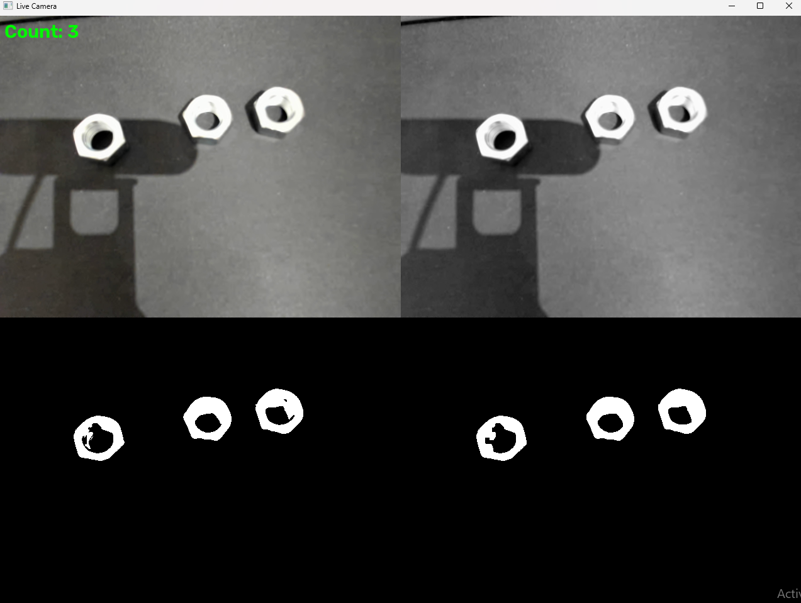
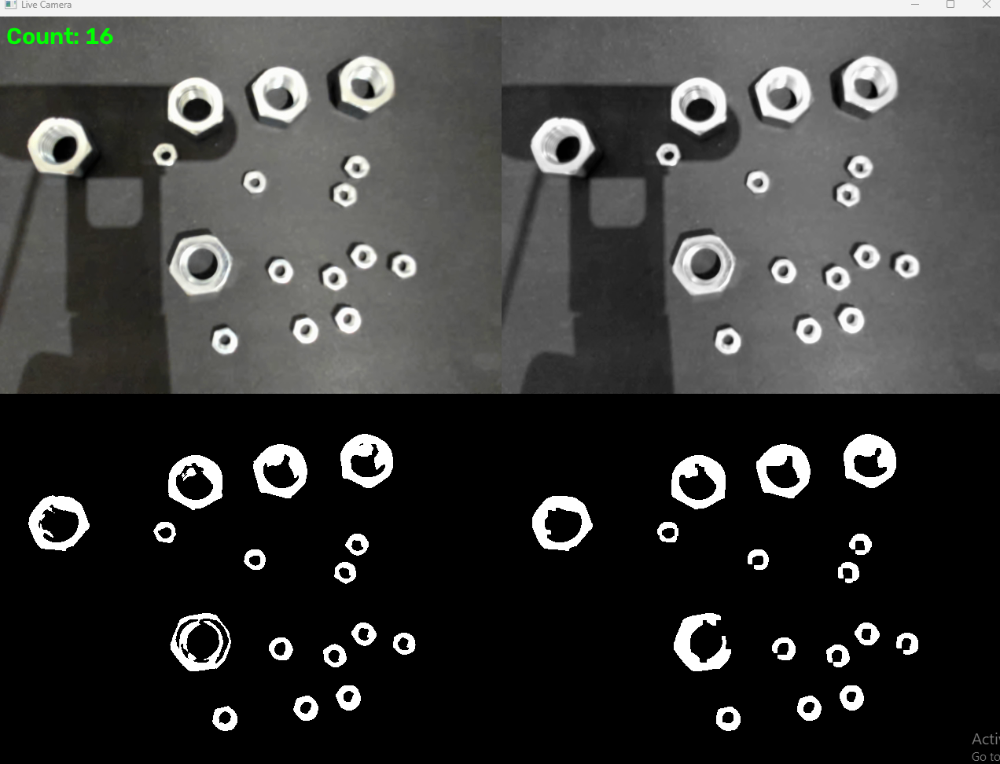

# Computer Vision Part Counting

This project counts parts from a live camera feed using concepts from my visual computing course. It will be my final project submission.

My goal is to learn the full pipeline, from capturing my own images to the counting algorithm. I kept the scope small on purpose so I can deeply understand the core concepts myself instead of trying to do a lot and relying on AI at every step.

## Demo

The live window shows four views of the pipeline in a 2x2 grid, with the live part count in the top-left corner:

| | |
|---|---|
| Original camera feed | Grayscale |
| Binary threshold | Morphological closing + opening |

**3 nuts:**



**16 nuts of mixed sizes:**



## Pipeline

1. **Capture**: grab frames from the webcam with OpenCV
2. **Grayscale conversion**: weighted sum of the BGR channels (NumPy)
3. **Binary thresholding**: pixels above 125 become white, the rest black (NumPy)
4. **Morphological closing and opening**: fill gaps inside parts, then remove small noise (OpenCV)
5. **Connected component labeling**: count the white blobs larger than a minimum area (OpenCV)

## Project Structure

```
main.py                          # Entry point
functions/
    camera_script.py             # Live camera loop and display
    gray_scale.py                # Grayscale conversion
    binary_thresholding.py       # Binary thresholding
    morph_close_open.py          # Morphological closing and opening
    counting.py                  # Connected component counting
images/                          # Demo screenshots
```

## Running

Install the dependencies and run the main script:

```
pip install numpy opencv-python
python main.py
```

Press **Q** to close the camera window.

## Progress

### Done (as of 10/26/2026)

- Grayscale conversion (NumPy)
- Binary thresholding (NumPy)
- Morphological closing and opening (OpenCV)
- Connected component labeling (OpenCV)
- Live camera feed with transformation views and live count

### To Do

- Implement morphological closing and opening with NumPy
- Implement connected component labeling with NumPy
- Take a more experimental approach to presenting results, not just showing that I counted some number of parts
