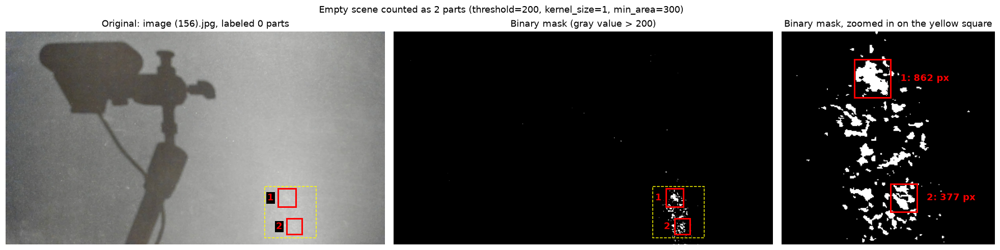
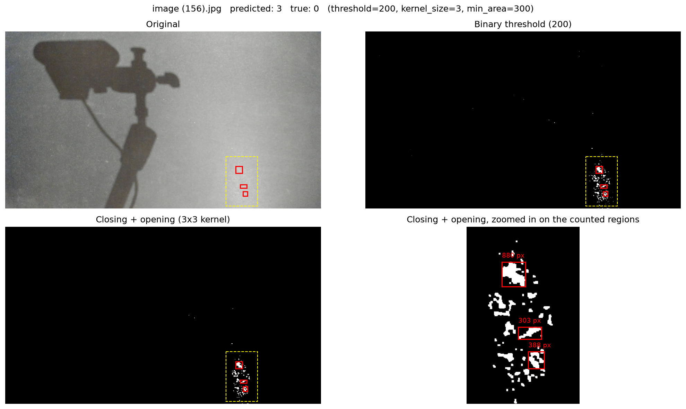
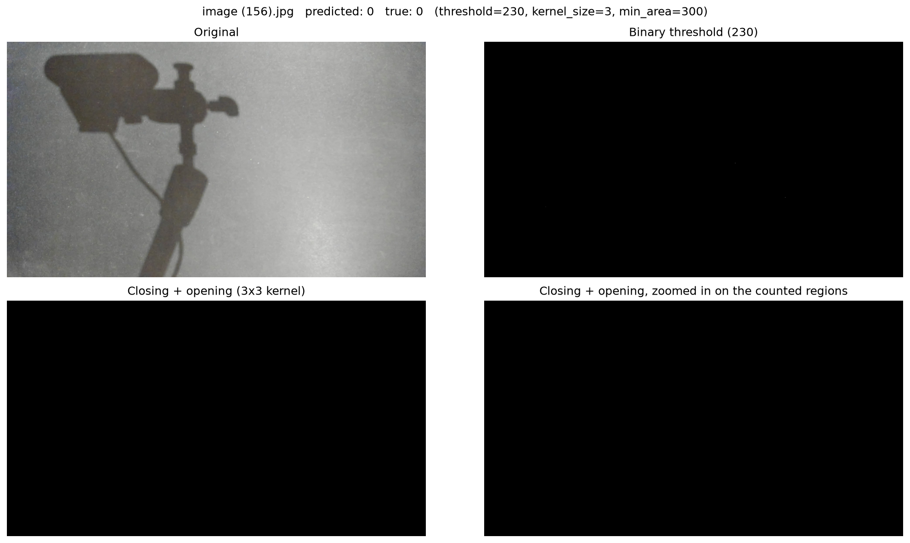
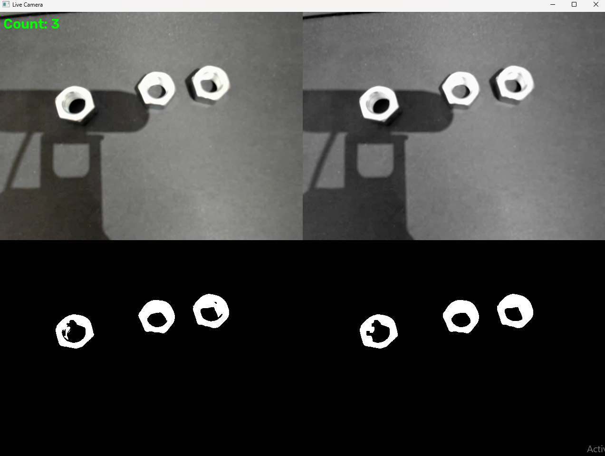
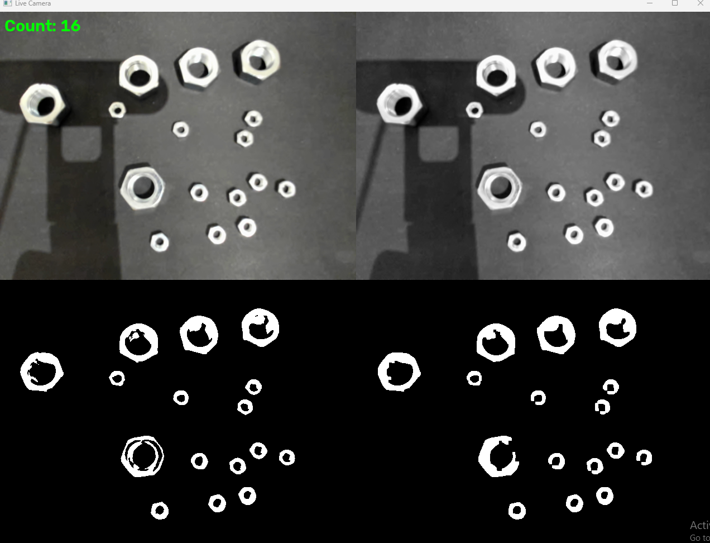

# Computer Vision Part Counting

This project counts parts from a live camera feed using concepts from my visual computing course. It will be my final project submission.

My goal is to learn the full pipeline, from capturing my own images to the counting algorithm. I kept the scope small on purpose so I can deeply understand the core concepts myself instead of trying to do a lot and relying on AI at every step.

**AI use:** I wrote the core implementation in `functions/`, and every experiment below runs that code. The experiments were set up by AI and guided by me, since I was the one looking for specific results. That covers the settings sweep and the cells that draw boxes around the counted regions so I can examine a single image.

## Results

I ran the pipeline on 156 labeled images (0 to 23 parts each) with 120 combinations of binary threshold, morphology kernel size, and minimum blob area. The full sweep is in [validation_and_testing.ipynb](validation_and_testing.ipynb).

The best combination at each threshold, plus the defaults the live camera uses:

| Threshold | Kernel size | Min area (px) | Exact count | Mean abs. error (parts) | Mean error (parts) | Note |
|---|---|---|---|---|---|---|
| 140 | 5 | 300 | 12.2% | 2.78 | 0.00 | |
| 160 | 3 | 1000 | 26.9% | 1.23 | +0.45 | |
| 180 | 1 | 1000 | 59.0% | 0.63 | 0.00 | |
| **200** | **1** | **300** | **77.6%** | **0.26** | **-0.07** | Best overall |
| 200 | 3 | 300 | 64.7% | 0.55 | -0.17 | Defaults in `functions/` |
| 220 | 5 | 300 | 69.9% | 0.42 | -0.23 | |
| 240 | 1 | 300 | 56.4% | 0.54 | +0.28 | |

- **Exact count**: share of the 156 images where the predicted count equals the true count
- **Mean abs. error**: how many parts the count is off by on average
- **Mean error**: positive means it overcounts, negative means it undercounts

What I learned:

- The best setting counts 121 of 156 images exactly right. Of its 35 misses, 30 are off by one part.
- The threshold has a big effect. The best any combination does at threshold 140 is 12.2%, against 77.6% at 200. The worst combination overall (threshold 160, kernel size 5, minimum area 100) got no image right and overcounted by about 27 parts per image.
- A kernel size of 1 means closing and opening do nothing, and that scored higher than the 3x3 kernel in my defaults (77.6% against 64.7% with the same threshold and minimum area).

### A failure I can explain

`image (156).jpg` is an empty scene (labeled **0**), but the best setting counts **2** parts.



The surface is not evenly lit. Inside the two red boxes the empty background has an average gray value of 204 to 205, just above the threshold of 200, so it turns white in the mask. The mask has 148 white regions and two of them (862 and 377 pixels) are big enough to pass the 300 pixel area cutoff, so each one is counted as a part.

The threshold only looks at brightness, so it cannot tell a bright patch of background from a part. A threshold of 220 gives 0 for this image, but the best accuracy at 220 is 69.9%, so one fixed threshold does not fit every lighting condition. The figure comes from the last section of [Part_Counting.ipynb](Part_Counting.ipynb).

#### Trying a 3x3 kernel and a higher threshold

I tested two more settings on this image with section 3 of [validation_and_testing.ipynb](validation_and_testing.ipynb), keeping the minimum area at 300:

| Threshold | Kernel size | Predicted (true is 0) |
|---|---|---|
| 200 | 1 | 2 |
| 200 | 3 | 3 |
| 230 | 3 | 0 |

**Threshold 200 with a 3x3 kernel counts 3 parts.** Closing and opening do not remove the false detections. Closing runs first and joins nearby specks together, so one more region (303 pixels) passes the area cutoff.



**Threshold 230 with a 3x3 kernel counts 0 parts.** Only 5 pixels in the whole image are brighter than 230, and the opening removes them, so there is nothing left to count.



This fixes image 156, but it is not a better setting overall. Run on all 156 images, threshold 230 with a 3x3 kernel counts 75 exactly right (48.1%), compared to 121 (77.6%) for the best setting. Threshold 230 is not one of the values in the sweep table above.

## Demo

The live window shows four views of the pipeline in a 2x2 grid, with the live part count in the top-left corner:

| | |
|---|---|
| Original camera feed | Grayscale |
| Binary threshold | Morphological closing + opening |

**3 nuts:**



**16 nuts of mixed sizes:**



## Pipeline

1. **Capture**: grab frames from the webcam with OpenCV
2. **Grayscale conversion**: weighted sum of the BGR channels (NumPy)
3. **Binary thresholding**: pixels above 200 become white, the rest black (NumPy)
4. **Morphological closing and opening**: fill gaps inside parts, then remove small noise (OpenCV)
5. **Connected component labeling**: count the white blobs larger than a minimum area (OpenCV)

## Project Structure

```
main.py                          # Entry point
Part_Counting.ipynb              # Pipeline step by step on one photo, plus the image 156 failure case
validation_and_testing.ipynb     # Experiment notebook: settings sweep, images 156 and 29 in detail, my functions against OpenCV
functions/
    camera_script.py             # Live camera loop and display
    gray_scale.py                # Grayscale conversion
    binary_thresholding.py       # Binary thresholding
    morph_close_open.py          # Morphological closing and opening
    counting.py                  # Connected component counting
    separate_touching.py         # Placeholder for separating touching parts
images/                          # Demo screenshots and the figures saved by the notebooks
    captured_images/             # Labeled test images
    labels.xlsx                  # True part count for each test image
```

## Running

Install the dependencies and run the main script:

```
pip install numpy opencv-python
python main.py
```

Press **Q** to close the camera window.

The experiment notebook needs a few more packages:

```
pip install pandas matplotlib openpyxl ipykernel
```

## Progress

### Done (as of 10/26/2026)

- Grayscale conversion (NumPy)
- Binary thresholding (NumPy)
- Morphological closing and opening (OpenCV)
- Connected component labeling (OpenCV)
- Live camera feed with transformation views and live count
- Settings sweep on 156 labeled images and one failure explained visually (added November 2026)
- Dilation and erosion written out with NumPy in `morph_close_open.py` (the pipeline still calls OpenCV)
- Compared my NumPy implementations against the OpenCV ones, both the results and how long they take (section 4 of [validation_and_testing.ipynb](validation_and_testing.ipynb))
- Presentation outline drafted

### To Do

- Implement connected component labeling (the counting) with NumPy
- Maybe separate touching parts so each one is counted (`separate_touching.py`)
- Turn the presentation outline into slides
